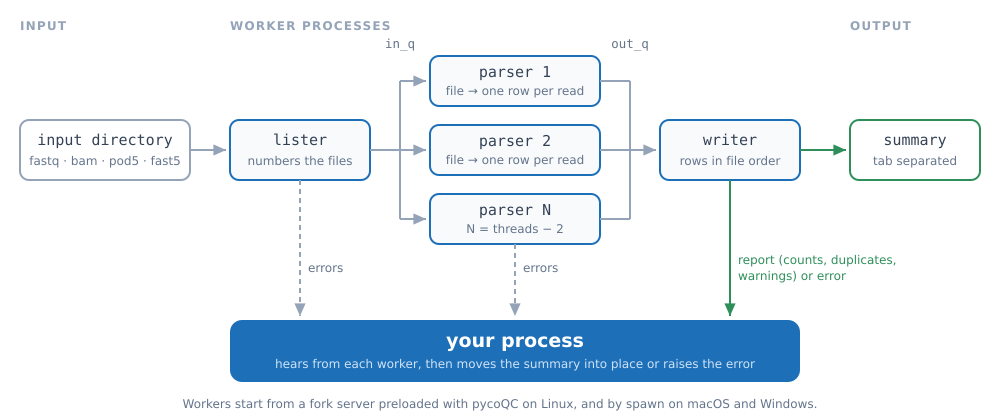

# Development

## Setup

```bash
git clone https://github.com/duceppemo/pycoqc-ng.git
cd pycoqc-ng
pip install -e ".[dev,notebook]"
```

Or with conda, which saves compiling `pysam`:

```bash
conda create -n pycoqc-ng-dev -c conda-forge -c bioconda \
  python=3.11 pysam pod5 pandas numpy scipy plotly jinja2 h5py tqdm python-dateutil pip
conda activate pycoqc-ng-dev
pip install -e ".[dev,notebook]"
```

## Tests

```bash
pytest                      # whole suite
pytest tests/test_cli.py    # one file
pytest -k barcode           # by name
pytest --cov --cov-report=term
```

Fixtures in `tests/conftest.py` synthesise FASTQ and Dorado-style BAM so the suite needs
no large inputs. Tests that need a real summary use the Guppy and Albacore summaries in
`tests/data/`.

Coverage is configured for multiprocessing in `pyproject.toml`. The converters parse in
worker processes, so without `concurrency = ["multiprocessing", "thread"]` that code
reads as untested even when it runs.

## Linting

```bash
python -m pyflakes pycoQC tests
```

This runs in CI and must stay clean. It only became useful once the star imports were
removed: pyflakes cannot resolve names coming from `import *`, so prefer explicit
imports.

## Layout

```
pycoQC/
  __main__.py              argument parsing for all six commands
  pycoQC.py                the top-level entry point
  pycoQC_parse.py          reads summary, barcode and BAM files into dataframes
  pycoQC_plot.py           composes the plot families below into one class
  plots/                   one module per plot family, each a mixin
    base.py                the read sets, run properties and shared helpers
    tables.py              summary tables and the JSON report's statistics
    distributions.py       1D and 2D read distributions
    over_time.py           yield and distributions over the run
    run_health.py          end reasons, active pores, channel activity
    barcodes.py            counts and boxplots per barcode
    alignment.py           alignment outcomes, rates and coverage
  _pipeline.py             the worker processes the converters share
  _forkserver_preload.py   what the converters' fork server imports
  _worker_env.py           the thread caps the converters' workers start with
  pycoQC_report.py         assembles plots into HTML and JSON
  common.py                shared helpers, errors and logging
  *_to_seq_summary.py      the four converters
  Barcode_split.py         splits a summary per barcode
  templates/               default config and Jinja2 template
recipe/                    conda recipe, mirrored into bioconda
docs/wiki/                 these pages
docs/images/               diagrams and example figures for these pages
tests/
```

Adding a plot means a method returning a plotly figure in the module of its family under
`pycoQC/plots/` (a new family is a new mixin, added to the class in `pycoQC_plot.py`), plus an entry
in `templates/pycoQC_config.json`, or in `templates/pycoQC_config_signal.json` if it
belongs in the shorter report for runs that have not been basecalled. A plot whose data
is missing should raise `pycoQCError`, which the report catches and skips.

## How the converters work



All four converters run the same pipeline, `ConverterPipeline` in `pycoQC/_pipeline.py`:

* the **lister** walks the input directory and queues the files on `in_q`, numbered in
  the order they were listed;
* `threads - 2` **parsers** each take a file, turn it into one row per read, and send
  the rows on `out_q` in batches of up to 1,000, tagged with the file's number;
* the **writer** puts the batches back in file order, drops repeated read ids where the
  converter asks for that, writes the summary under its own name in a directory of
  this run's own beside it (`.pycoqc-<random>/`), so compression is still inferred from
  the name, and sends back a report;
* the **calling process** waits for every worker to exit, checks once more that none
  sent an error, then moves the file into place and logs the report. Otherwise it
  raises the first error. Either way the directory is removed. A worker that
  dies without sending anything is noticed from its exit code. Renaming only after
  every worker has finished means a failed conversion never leaves a summary that
  looks complete.

The FASTQ converter is the one exception to "a file per item": a file well over an
even share of the input (`WHOLE_FILE_SLACK` times the total over the parser count, with
gzipped files counted at `GZIP_RATIO` times their size on disk) is split by the lister
into blocks of reads, so that one large file among small ones is still parsed by every
parser. Files of about the same size are not split even when there are fewer of them
than parsers: the lister reads a split file alone, and that costs more than an idle
parser. Repeated read ids are told apart by file (`_item_file`), not by work item.

Workers start with the thread caps in `_worker_env.py`: OpenBLAS and pyarrow's
jemalloc start threads as they load, which in a pool of parsers is idle threads per
core in every worker. On Linux the workers start from a fork server that preloads
pycoQC (`_forkserver_preload.py`); the caps keep it single threaded, which matters
because forking a process that holds threads can deadlock the child. On macOS and
Windows they start by spawn. Either way each worker imports the calling script again
as it starts, which is why a script calling a converter needs an
`if __name__ == "__main__":` guard.

A converter is a subclass that sets `kind` and `extensions`, calls `_configure` with
the arguments every converter takes, stores its own, and calls `_run`. It implements
`_records(item, counts)`, yielding one dict per read for an input file, and optionally
`_finalise(df, notes)` for a last change to the table. Strings appended to `notes` are
logged as warnings by the calling process. `unique_read_ids` and `no_reads` adjust
duplicate handling and the error for input holding no reads.

The stage methods run in other processes and receive a pickled copy of the converter.
Anything they need must be an instance attribute set before `_run`: a value changed on
the class in the calling process does not reach them. Logging is the same: a worker's
log lines go to its own stderr, so anything the user must see belongs in the report.

## CI

* `ci.yml` runs the suite on Python 3.9 to 3.13 plus macOS, lints with pyflakes, builds
  the distributions and checks that a clean install from the sdist works outside the
  repository.
* `publish.yml` publishes to PyPI via Trusted Publishing. A manual dispatch can target
  TestPyPI first.
* `wiki.yml` syncs `docs/wiki/` to the GitHub wiki on push.

## Releasing

1. Update `__version__` in `pycoQC/__init__.py`, which `pyproject.toml` reads.
2. Add a `CHANGELOG.md` entry.
3. Update `version`, `date-released` and the DOI list in `CITATION.cff`.
4. Tag and push: `git tag -a vX.Y.Z -m "..." && git push origin vX.Y.Z`.
5. Publish a GitHub release for the tag. That uploads to PyPI and, through the Zenodo
   webhook, archives the release and mints a DOI.
6. Update `recipe/meta.yaml`: new `version`, `build: number: 0`, and the sha256 of the
   new sdist:

   ```bash
   curl -s https://pypi.org/pypi/pycoqc-ng/json \
     | python -c "import sys,json; print([f['digests']['sha256'] for f in json.load(sys.stdin)['urls'] if f['packagetype']=='sdist'][0])"
   ```

7. Open a PR against [bioconda-recipes](https://github.com/bioconda/bioconda-recipes)
   updating `recipes/pycoqc-ng/meta.yaml`.

Zenodo only archives releases published *after* its webhook was enabled. If a release
is missed, deleting and recreating it on GitHub re-fires the event; the publish workflow
passes `skip-existing`, so the repeated PyPI upload is a no-op.

## Conventions

Match the surrounding code rather than reformatting it. Explicit imports, no `import *`.
Comments should explain why something is done, especially where it guards against a bug
that has already happened once.
